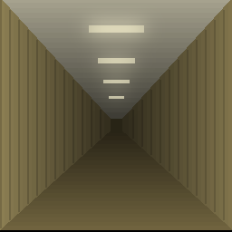

# Minecraft 統合版（Backrooms Level 0）

Minecraft 統合版（Bedrock Edition）に、オーバーワールドから独立した専用ディメンション `backrooms:level0` を足し、
The Backrooms の **Level 0**（黄ばんだ壁紙・湿ったカーペット・鳴り止まない蛍光灯のハム音が、どこまでも続く部屋）を
歩いた先から無限に生成するアドオン。床の穴から落ちた先の **Level 1** もある。

Minecraft の非公式アドオンです。Mojang Studios / Microsoft とは関係ありません。
題材の The Backrooms と Backrooms Wiki の公認でもありません（[5. 元ネタとクレジット](#5-元ネタとクレジット)）。

- 版: v0.5.0
- 遊ぶ人向けの案内は [ガイドブック.md](ガイドブック.md)（入り方・帰り方・迷わない方法・出会うもの・困ったとき）

---

## 1. まずこれを確認する（Beta APIs が要らないか）

`@minecraft/server` は正式版の 2.10.0 だけを使い、beta トラックは使っていない。
型定義に beta の注記が無いことから、ワールドの実験トグル「Beta APIs」は要らないと判断しているが、**実機ではまだ確かめていない**。

- ワールド作成画面で「Beta APIs」を **OFF のまま**アドオンを適用し、Level 0 に入れれば問題ない
- もし実験トグルが必要だった場合、トグルを入れたワールドは実績が恒久的に無効になる。**最初は捨ててよいワールドで試してほしい**

ディメンションの登録は、JSON 定義（`BackroomsBP/dimension/`）とスクリプトの `registerCustomDimension` の両方を入れてあり、
どちらが効いてもよいようにしてある。どちらが効いたかはコンテンツログに `[backrooms]` で出る。

---

## 2. 入れ方

ビヘイビアパック（`BackroomsBP`）とリソースパック（`BackroomsRP`）の **2 つで 1 セット**。
リソースパックが無いと、壁も床も天井も「未知のブロック」になる。BP が RP を依存として宣言しているので、BP を有効にすれば RP も付く。

### .mcaddon を作って取り込む

Python 3 があれば、リポジトリの根で:

```
python tools/build_mcaddon.py            # dist/backrooms_level0.mcaddon を作る
python tools/build_mcaddon.py --deploy   # Minecraft の development_*_packs へ直接置くこともする（Windows）
```

`dist/backrooms_level0.mcaddon` をダブルクリックで取り込み、ワールドの設定でビヘイビアパックを有効にする。
フォルダで入れるなら、`BackroomsBP` と `BackroomsRP` を `com.mojang` の下の `development_behavior_packs` と `development_resource_packs` に置く。

**入れたあと、Minecraft を完全に終了して起動し直す。** カスタムの音（ハム音）はワールドの入り直しでは読み込まれない。

### 動作環境

- Minecraft 統合版 **1.26.50 以降**（作者の確認環境は 1.26.51）。マルチプレイでは参加者全員が同じ版
- Script API: `@minecraft/server` **2.10.0**（他の多くのアドオンが使う 2.0.0 より新しい）。
  1.21.x では `registerCustomDimension` が無いので動かない

---

## 3. 遊び方

| したいこと | 方法 |
|---|---|
| Level 0 へ入る | 作業台で、**中央にエンダーパール 1 個・周りの 8 マスに黄色いカーペット**で「ノークリップ」を作って使う（1 個で 1 回） |
| 帰る | 緑の**出口のドア**に触れる（拠点には必ず 1 つある）／マニラルームの部屋に 30 秒いる／長く歩き続ける |
| 帰れなくなった | `/backrooms:leave`（誰でもいつでも使える。Level 1 からでも） |

- 着く場所は拠点（X・Z が 0〜15 のセル）。壁が無く蛍光灯が多い、唯一の安全地帯。**X と Z を 0 に近づければ拠点に戻れる**
- 部屋の並びは座標から決まるので、同じ場所に戻れば同じ部屋がある。置いたブロックも残る。壁は素手で壊せる（床・天井・蛍光灯は壊せない）
- 霧と蛍光灯のハム音。10 ブロック先から霞み、24 ブロックで見えなくなる
- ランドマーク 9 種（巨大空間・暗区画・水区画・行き止まりの階段・長い廊下・柱の広間・小部屋の区画・マニラルーム・Level 1 へ落ちる穴）
- 遺留品 7 種（キャンプ跡・物資チェスト・看板・使い込まれた装備・事務机と椅子・手記・壁の落書き）と、飲むと悪い効果が消えるアーモンドウォーター
- 住人 3 種: 襲わないフェイスリング、背後から追ってくるハウンド（見つめ返すと一度だけ止まる）、暗区画にだけ出るスマイラー（光と火に弱い）。
  ピースフルではハウンドとスマイラーは出ない。拠点とマニラルームには入ってこない
- Level 1: コンクリートの倉庫。物資の樽があり、階段を上りきると Level 0 の拠点へ戻る
- Level 0 / Level 1 では地図が描けない。ベッドでは寝られない

---

## 4. コマンド

| コマンド | 権限 | 内容 |
|---|---|---|
| `/backrooms:enter` | 誰でも | Level 0 へ入る（ノークリップを使わない） |
| `/backrooms:leave` | 誰でも | 元の世界へ帰る（Level 1 からでも） |
| `/backrooms:regen [半径]` | GameDirectors | 現在地のまわりを作り直す（半径 0〜4 セル）。**置いたブロックも消える** |
| `/backrooms:tp <x> <z>` | GameDirectors | いる階層の中の座標へ移動 |
| `/backrooms:rate <キー> <値>` | GameDirectors | 出現率などをその場で変える。リロードで既定値に戻る |
| `/backrooms:dump` | GameDirectors | 現在のセルの種類・生成キューの長さなどを出す |
| `/backrooms:selftest` | GameDirectors | 実機での自己点検。ディメンション・ブロック・住人・霧・生成などを 1 行ずつ OK / NG / -- で出す |

住人を出したくないときは `/backrooms:rate HOUND_CHANCE 0` のように出現率を 0 にする（`SHADOW_CHANCE` / `HOUND_CHANCE` / `SMILER_CHANCE`）。
既定値を変えるなら `BackroomsBP/scripts/config.js` の `TUNING`。

---

## 5. 元ネタとクレジット

- 題材は **The Backrooms**（2019 年に匿名掲示板への 1 枚の写真の投稿から広がった、インターネット上の共同創作）と、
  **Backrooms Wiki**（<https://backrooms.fandom.com/>）の Level 0、Level 1「The Habitable Zone」、Level 0 の「The Manila Room」、
  Entity 3「Smilers」・Entity 8「Hounds」・Entity 9「Facelings」、Object 1「Almond Water」の記述。
  Backrooms Wiki の文章は、それぞれの執筆者による CC BY-SA ライセンスの作品
- このアドオンは、それらの設定（場所の雰囲気・住人の特徴・帰り方など）を元に、形・見た目・動きを作り直したもの。
  **Backrooms Wiki の文章や画像、元の写真は同梱していない。**
- テクスチャ・ブロックとエンティティのモデル・アイコン・ハム音は、すべて `tools/` のスクリプトがプログラムで描いた・合成したもの。
  看板・手記・メッセージなどゲーム内の文章も、このアドオンのために書いたもの

---

## 6. 開発

Node.js と Python 3 を使う。テストは Minecraft 無しで、実際のスクリプトを偽のワールドで動かす。

```
node tools/validate.cjs        # 参照の整合性と、禁止事項（Math.random・タイマーの本数など）の機械チェック
node tools/test_layout.mjs     # レイアウト: 決定論性・境目の連続性・壁密度・ランドマーク・小物の配置
node tools/test_layout1.mjs    # Level 1 のレイアウト
node tools/test_load.mjs       # 全モジュールの読み込みとタイマーの本数
node tools/test_scheduler.mjs  # 走るプレイヤーに生成が追いつくか・落ちた人の救出
node tools/test_entities.mjs   # 住人 3 種の出る場所と消える条件
node tools/test_selftest.mjs   # 自己点検が最後まで走るか
```

公式の型定義（`@minecraft/server` 2.10.0）との型チェックは別の道具で行っていて、このリポジトリには入っていない。
型定義は `npm install` で `node_modules/` に入る（テストを回すだけなら要らない）。

生成スクリプト（作り直すと PNG・JSON・音が書き換わる）:

| スクリプト | 作る物 |
|---|---|
| `tools/gen_textures.py` | ブロック・小物・マニラルーム・Level 1 のテクスチャ、アイテムのアイコン、パックのアイコン（Pillow） |
| `tools/gen_blocks.py` | 小物 13 種のブロック JSON と形 |
| `tools/gen_entities.py` | 住人 3 種のモデルとテクスチャ（Pillow） |
| `tools/gen_hum.py` | 10 秒ちょうどでつながるハム音（numpy。ffmpeg があれば ogg、無ければ wav） |

---

## 7. 実機での確認が済んでいないこと

作者が一度実機で遊んで「時刻で明るさが変わる」と分かり、v0.5.0 で霧を時刻で差し替えた。**それ以外の実機での確認はまだ。**
試すときは、Level 0 の中で最初に `/backrooms:selftest` を打つと、下の多くが OK / NG で分かる。

| # | 何を | どう見るか |
|---|---|---|
| Q-9 | Beta APIs のトグルが要らないか | 1 節 |
| Q-1 | ディメンションの登録の経路と `minecraft:default_biome` の書式 | コンテンツログ。登録されなければ `BackroomsBP/dimension/level0.json` の `default_biome` を `{"minecraft:plains": {}}` の形に変える |
| Q-10 | 生成が歩く速さに追いつくか | 斜めに 500 ブロック走り、床の途切れが見えないか。遅いホストでも落ちはしない（足元はその場で作り、落ちた人は床へ戻す）が、カクつく |
| Q-12 | 水区画の水が外へ流れ出さないか | 水区画を見つけたら一度離れて戻る |
| — | 住人の見た目と動き | `/summon backrooms:shadow`・`hound`・`smiler`（拠点の外で）。ハウンドの速さ、暗い所で目だけが光るか、見つめ返しで止まるか、スマイラーが火以外で傷つかないか |
| — | 小物の向き・点滅する蛍光灯・明るさ | 壁の小物が壁を背にしているか、天井 Y=6 で暗すぎないか |
| — | 穴と Level 1、長く歩くとマニラルーム、地図とコンパス | selftest の「近くの目印」に出る穴へ `/backrooms:tp` で行って飛び降りる。`/backrooms:rate MANILA_WALK_BLOCKS 100` で歩く距離を短くして試す |
| — | ワールドの容量 | 1 人で 1 時間歩いたときにワールドのフォルダがどれだけ増えるか |

---

## 8. ライセンス

このリポジトリのコードと、スクリプトで作った素材（テクスチャ・モデル・音）は [MIT](LICENSE)。
題材の The Backrooms と Backrooms Wiki の記述は、それぞれの作者のもの（このリポジトリには含めていない）。
